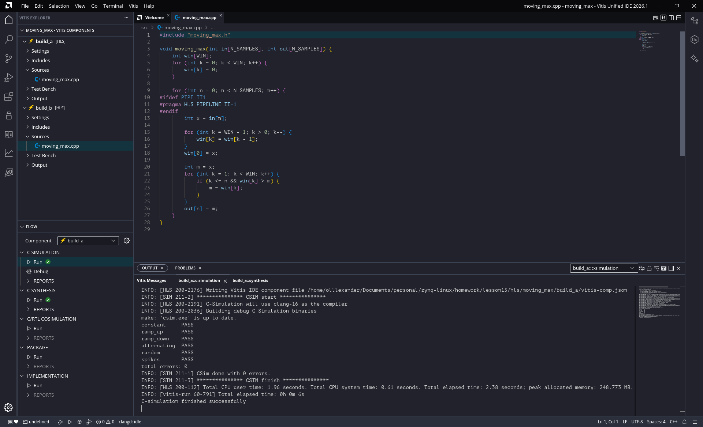
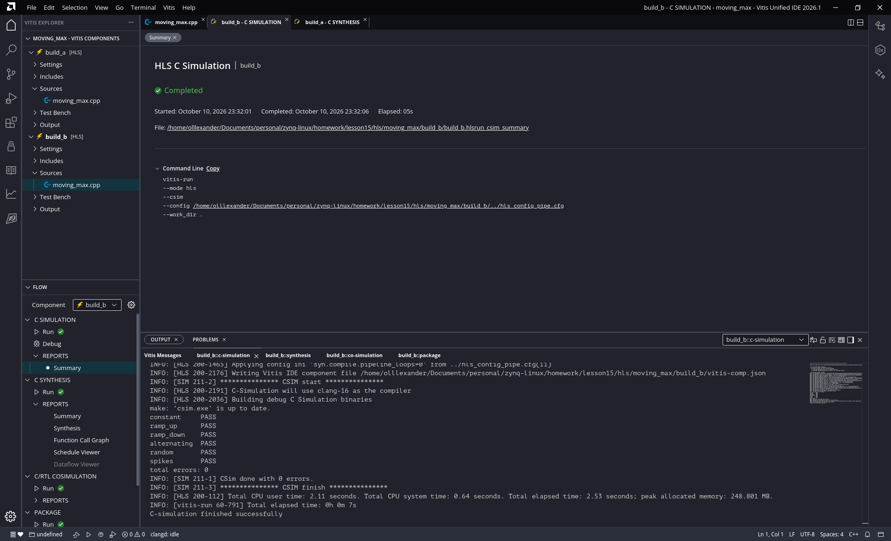
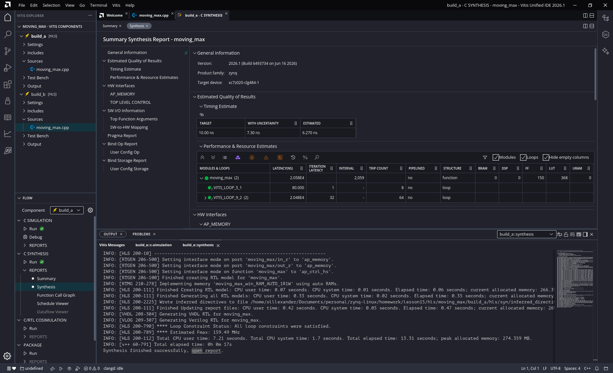
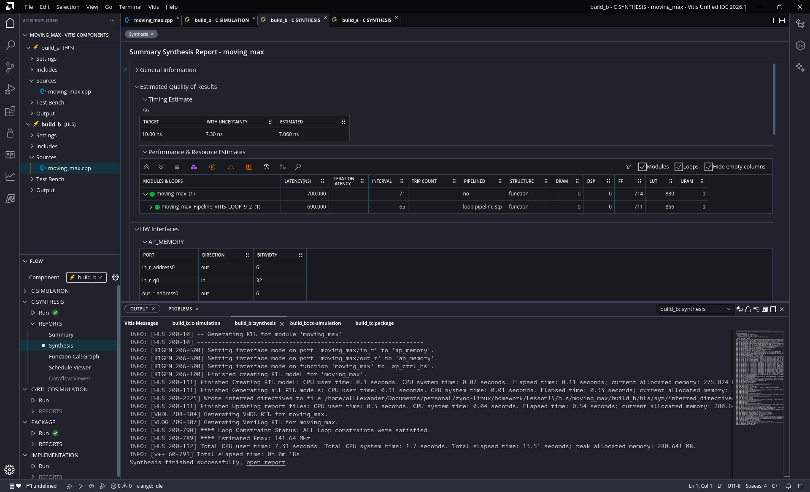
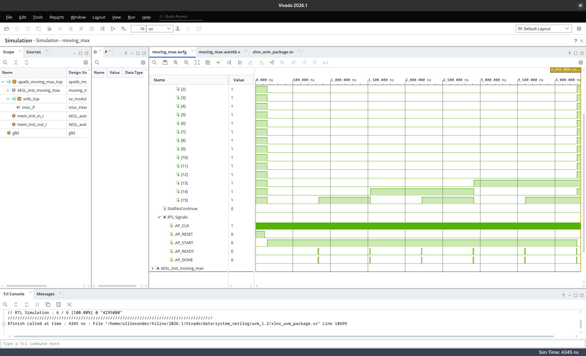
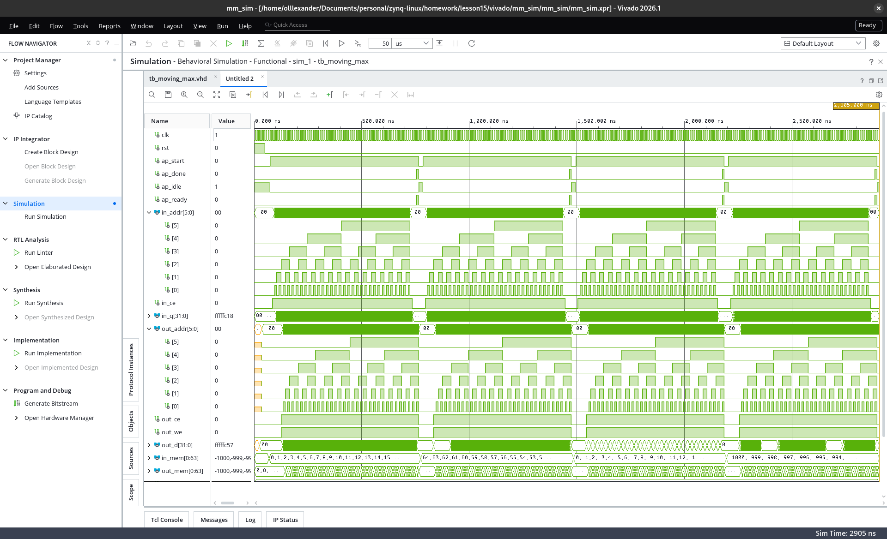

# Звіт — домашнє завдання після лекції 15

**Тема:** Vitis HLS — IP ковзного максимуму (`moving_max`, вікно 8 із 64 відліків): C++ → RTL, порівняння збірки без конвеєра та з `PIPELINE II=1`, Co-simulation, Package, симуляція IP у Vivado.
**Інструменти:** Vitis HLS 2026.1 (unified IDE, HLS component), Vivado 2026.1 (XSim).
**Плата:** Smart ZYNQ SL (XC7Z020-CLG484), part `xc7z020clg484-1`, такт 10 нс (100 МГц). Завдання суто симуляційне.

---

## Алгоритм

Правило: `out[n] = max(in[n-7] … in[n])`, для `n < 7` — максимум з наявних `in[0] … in[n]`.

Реалізація (`moving_max.cpp`) — один цикл по 64 відліках зі **зсувним регістром `win[8]`**: кожен `in[n]` читається
рівно один раз, заштовхується у `win[0]`, старші елементи зсуваються, максимум береться з `win[]` сімома порівняннями.
Для перших семи відліків елементи `win[k]` з `k > n` ще не заповнені — вони відкидаються умовою `k <= n`, тому
ініціалізація регістра нулями не впливає на результат навіть для від'ємних вхідних даних.

Альтернатива — вкладений цикл по `in[n-k]` — читала б кожен елемент до 8 разів, порушуючи умову, і в HLS
дала б 8 звернень до памʼяті на відлік замість одного.
дала б 8 звернень до памʼяті на відлік замість одного.

Прагма конвеєра обгорнута макросом, щоб обидва варіанти збирались з одного файлу:

```cpp
#ifdef PIPE_II1
#pragma HLS PIPELINE II=1
#endif
```

Тестбенч `tb_moving_max.cpp`: еталон прямим перебором за правилом вище, 6 векторів (константа, зростаючий,
спадний, знакозмінний, випадковий із seed, два піки на тлі від'ємних), `main` повертає 0 при збігу і 1 при помилці.

---

## HLS-компонент

- `hls/moving_max/src/moving_max.cpp`, `src/tb_moving_max.cpp` (еталон перебором, N векторів, повертає 0/1).
- Конфіг `hls_config.cfg` — варіант **A** (без директив, `syn.compile.pipeline_loops=0` — автоконвеєризація циклів вимкнена);
  `hls_config_pipe.cfg` — варіант **B** (`-DPIPE_II1` вмикає `#pragma HLS PIPELINE II=1`).

### C Simulation

Обидва варіанти: 6 векторів (constant, ramp_up, ramp_down, alternating, random, spikes), `total errors: 0`, `CSim done with 0 errors`.




### C Synthesis — A vs B

| | A: без конвеєра | B: `PIPELINE II=1` |
|---|---|---|
| Latency, тактів | **2058** (20.58 мкс) | **70** (0.70 мкс) |
| Interval | 2059 | 71 |
| Основний цикл (64 ітерації) | 32 такти/ітерація, не конвеєризований | II = 1, глибина конвеєра 5 |
| Внутрішні цикли (зсув, максимум) | 2 × 14 тактів, по черзі | розгорнуті у 7 компараторів |
| LUT | 368 | 880 |
| FF | 150 | 714 |
| DSP | 0 | 0 |
| BRAM | 0 | 0 |
| Оцінка такту, нс (ціль 10) | 6.27 | 7.06 |

> У GUI Vitis колонка Latency показує **наносекунди** (2.058E4 нс = 2058 тактів при 10 нс), у текстовому `.rpt` — такти.




Звідки різниця. У варіанті A кожна ітерація зовнішнього циклу виконує два внутрішні цикли по 7 ітерацій **послідовно**
(зсув, потім пошук максимуму), по 2 такти на крок — 32 такти на відлік, 64 × 32 = 2048 плюс службові. У варіанті B
`PIPELINE II=1` змушує HLS **повністю розгорнути** внутрішні цикли: зсувний регістр стає 8 паралельними тригерами,
пошук максимуму — деревом із 7 компараторів, і новий відлік стартує щотакту. Латентність ≈ 64 + глибина конвеєра (5) + накладні.
Ціна — у ~2.4× більше LUT і ~4.8× більше FF: регістри `win[]` плюс конвеєрні ступені. DSP не потрібні в обох випадках (лише порівняння).

### Co-simulation

C/RTL co-simulation варіанта B: **PASS**, 6 прогонів (по одному на вектор), RTL-латентність 68 тактів, інтервал 69. На хвилях cosim (`cosim.wave_debug`) видно 6 пар `AP_READY`/`AP_DONE` при утримуваному `AP_START`.



### Package

`package.output.format=ip_catalog` → `build_b/hls/impl/ip` (+ `moving_max.zip`). Інтерфейс IP: керування
**`ap_ctrl_hs`** (`ap_start/ap_done/ap_idle/ap_ready`), масиви `in`/`out` — порти **`ap_memory`**
(`in_r_address0[5:0]`, `in_r_ce0`, `in_r_q0[31:0]`; `out_r_address0[5:0]`, `out_r_ce0`, `out_r_we0`, `out_r_d0[31:0]`), тобто IP
очікує зовні два BRAM. Пакет скопійовано у `vivado/mm_sim/ip_repo/moving_max` як IP-репозиторій для Vivado.

---

## Симуляція IP у Vivado (VHDL-тестбенч)

Проєкт `vivado/mm_sim/mm_sim.xpr` (VHDL-2008, лише симуляція; створюється скриптом `create_project.tcl`,
headless-прогін — `run_sim.tcl`). IP `moving_max_0` додано з каталогу (`ip_repo`).

Тестбенч `tb_moving_max.vhd` емулює те, чого IP потребує ззовні: **два BRAM під `ap_memory`** — `in_mem` читається з
латентністю один такт (`in_r_q0 <= in_mem(addr)` на фронті при `ce0`), `out_mem` пишеться при `we0`. Сценарій на кожен
вектор: завантажити `in_mem` → `ap_start='1'` → чекати `ap_done` (з таймаутом) → порівняти `out_mem` з еталонною
функцією `ref_moving_max`. 4 вектори (ramp_up, ramp_down, alternating, spikes) → **ALL PASS**.

На хвилях нижче: 4 прогони (`ap_start`/`ap_done`), під час кожного `in_r_address0` і `out_r_address0` рахують 0…63,
біт `[0]` адреси перемикається **щотакту** — це і є II=1 у залізі; `out_r_we0` тримається високим увесь прогін (запис кожного такту).



---

## Висновок

IP ковзного максимуму реалізовано у Vitis HLS за правилом із завдання, з одноразовим читанням кожного відліку
(зсувний регістр). C Simulation і C/RTL co-simulation пройшли на всіх векторах. Порівняння двох збірок показало, що
одна директива `PIPELINE II=1` зменшує латентність **з 2058 до 70 тактів (≈29×)** ціною ~2.4× LUT і ~4.8× FF без
жодного DSP: HLS розгорнув внутрішні цикли у паралельний зсувний регістр і дерево компараторів. Запакований IP
підключено до Vivado-проєкту з власним VHDL-тестбенчем, який емулює `ap_memory`-память; на хвилях видно II=1 (адреса
інкрементується щотакту) і 4 успішні прогони.